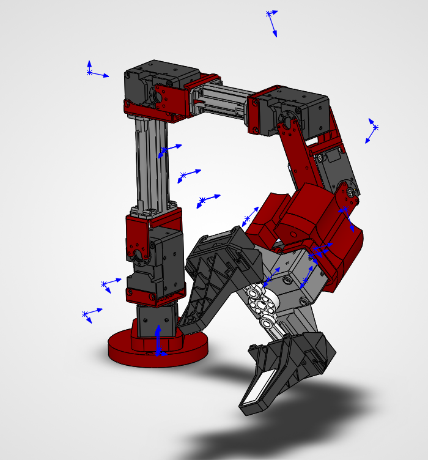
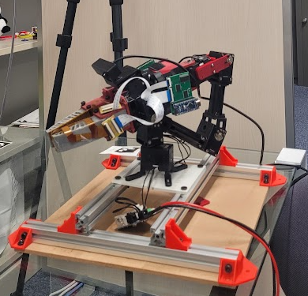

# OpenManipulator-X 6-DOF Hardware Control

A ROS 2 Humble driver package for real-time hardware control of a modified 6-DOF + Gripper OpenManipulator-X robotic arm (featuring a custom wrist-rotate joint) over serial communication using the Dynamixel SDK.

   

  

---

## Branches

`main` is the current, working version: the arm driver, teach and replay, and the camera tools described in this README. The other branches hold a single feature, an older snapshot or a part of the project kept apart from the ROS package. Start from `main` unless you need one of them.

| Branch | What it contains | Status |
| --- | --- | --- |
| `main` | Full package: hardware driver, teach pendant and sequence replay, D435 and wrist cameras, calibration tools | Current, use this |
| `teach-and-replay` | Teach pendant, gamepad control and sequence replay with logging, while it is being developed | Active, merges into `main` |
| `CAD` | CAD files for the arm, including the custom wrist-rotate joint (not part of the ROS package) | Active, kept separate |
| `safe-dynamixel-startup-and-session-logging` | Safer Dynamixel start-up (checks before torque is enabled) and session logging | Older, PR #26 |
| `calculating_T_settle` | Settling-time (T_settle) measurement for the joints | Older, PR #24 |
| `arm-driver-only` (was `version-2`) | Only the arm driver (`arm_driver.py`, `dynamixel_driver.py`): no teach and replay, no cameras | Snapshot, PR #19 |

- Branches marked "older" are well behind `main` and kept for reference. Merge `main` into them before reusing them.
- Use `arm-driver-only` if you only need joint control of the arm, for example to build your own application on top of the driver.

```bash
git clone <repo-url>
git checkout <branch>        # e.g. git checkout arm-driver-only
```

---

## Package Architecture

```text
open_manipulator_x6/
├── config/
│   ├── motors.yaml                      # Motor IDs, port settings, and baudrate
│   ├── joy_ps4.yaml                     # Gamepad button mapping for the teach pendant
│   ├── bottle_sequence.example.yaml     # Example replay sequence
│   ├── aruco_markers.yaml               # Workspace markers (D435): topics, sizes, base offset
│   └── wrist_camera.yaml                # Wrist camera (Elecom): device, resolution, calibration file
├── launch/
│   ├── arm.launch.py                    # Main ROS 2 launch file
│   ├── teach.launch.py                  # Teach pendant + gamepad
│   ├── bottle_test.launch.py            # Sequence replay with logging and bag recording
│   ├── workspace_markers.launch.py      # D435 + workspace marker checker
│   └── wrist_camera.launch.py           # Wrist camera (+ optional camera-frame checker)
├── open_manipulator_x6/
│   ├── __init__.py
│   ├── arm_driver.py                    # ROS 2 hardware interface node
│   ├── dynamixel_driver.py              # Low-level Dynamixel SDK handler
│   ├── utils.py                         # Math and unit conversion utilities
│   ├── pose_store.py, sequence.py, joy_teleop_core.py,
│   ├── sequence_executor.py, teach_pendant.py, sequence_runner.py   # Teach and replay
│   ├── aruco_core.py                    # Marker detection and pose math (no ROS)
│   ├── aruco_detector.py                # Marker checker node + window
│   ├── calibration_core.py              # Checkerboard calibration (no ROS)
│   └── camera_calibrator.py             # Guided calibration node + window
├── tools/
│   └── generate_aruco_markers.py        # Printable marker sheet
├── test/                                # pytest: python3 -m pytest test/ -q
├── resource/
│   └── open_manipulator_x6              # ROS 2 package index marker
├── package.xml
├── setup.cfg
└── setup.py
```

## Launching the Hardware Driver


```bash
ros2 launch open_manipulator_x6 arm.launch.py
```


## Teach and replay for the Open Manipulator X6

Teach named poses with the gamepad, then replay them as a sequence while the pads and arm are recorded.


### 1. Teach

Start `arm_driver` and the FlexiGrasp pad node as usual, then:

Note: Ensure to run the arm_driver with the parameter file as shown below.

```bash
ros2 run open_manipulator_x6 arm_driver --ros-args --params-file ~/Open-Manipulator-X-6/arm_params.yaml
```

   

```bash
ros2 launch open_manipulator_x6 teach.launch.py
```

| Button | Action |
| --- | --- |
| L1 / R1 | previous / next joint |
| circle / cross (hold) | move forward / reverse (gripper: close / open) |
| triangle | fine / coarse |
| square | save pose (name typed in the window) |
| options | STOP |

- Check the button numbers once: the grey line at the bottom of the window shows `last buttons pressed`. If any differs from the table in `config/joy_ps4.yaml`, edit the file and restart.
- Poses save the measured arm joints only. The gripper is not saved.
- With the gripper open wide enough for the bottle, press **Set gripper open = current position** once.
- Suggested poses for the bottle test: `home`, `pre_grasp`, `grasp`, `lift`, `carry`, `tilt`, `place`.
- Poses go to `~/Open-Manipulator-X-6/poses.yaml`.

### 2. Write the sequence

Copy `config/bottle_sequence.example.yaml` to `~/Open-Manipulator-X-6/bottle_sequence.yaml` and edit the steps. Step types: `move: <pose>`, `gripper: open|close`, `wait: <s>`, `speed: <n>`, `cap: <n>`, `rezero`, `mark: <label>`.

`gripper: close` closes in small steps until both pads report contact, then sets the target `squeeze_rad` past contact so the current cap sets the grip force. If no contact is found within `max_close_travel_rad`, it is logged as `no_contact` and the sequence carries on.

### 3. Replay and record

Close the teach pendant and the keyboard teleop first, so only the runner commands the arm.

```bash
ros2 launch open_manipulator_x6 bottle_test.launch.py \
  sequence:=~/Open-Manipulator-X-6/bottle_sequence.yaml label:=bottle_1
```

- Starts the session logger, a bag recording and the runner; all three stop when the sequence ends.
- 3 s countdown before the first move. Any `/arm_stop` (gamepad options, keyboard space, pendant STOP, Ctrl-C) aborts.
- Outputs in `~/flexigrasp_logs/`: `<stamp>_bottle_1.csv` (pads + joints + current step per row), `<stamp>_bottle_1_steps.csv` (one row per step: result, duration, contact position), `<stamp>_bottle_1_bag/`.
- Add the cameras with `extra_topics:="/camera/camera/color/image_raw /wrist_cam/image_raw"`.

### Safety notes

- Moves are point to point at the driver's profile velocity (30 in the example). Test a new sequence with `repeats: 1` and a hand near the power switch.
- Poses are replayed as saved, with no collision checking. Re-check poses after anything on the table moves.
- The empty PET bottle crushes easily: the example starts at a gripper cap of 80 (~0.22 A). Raise it in steps only if the bottle slips.

---

## Cameras

Two cameras:

| Camera | Role | Calibration |
| --- | --- | --- |
| Intel RealSense D435 | Global view of the workspace; marker positions in the robot frame | Factory values, published on `camera_info` (nothing to do) |
| Elecom webcam on the wrist | Close view from the gripper; marker distances from the camera | `camera_calibrator` (below), saved to `~/.ros/camera_info/wrist_cam.yaml` |

### Install

```bash
sudo apt install ros-humble-realsense2-camera ros-humble-v4l2-camera v4l-utils
```

The D435 needs a USB 3 port. If it is not found, install Intel's `librealsense2` packages (they add the USB permission rules and `realsense-viewer`), then replug it.

### Print the markers

```bash
python3 tools/generate_aruco_markers.py --out ~/aruco
```

Print `aruco_markers.pdf` at 100% (actual size) and check that the 50 mm scale bar measures 50 mm. Measure the black squares and put the real sizes in `marker_sizes_mm` in `config/aruco_markers.yaml`.

| ID | Name | Where |
| --- | --- | --- |
| 0 | base | Flat on the base frame, arrow pointing to the robot's front |
| 1 | bottle_start | Beside the bottle's start spot |
| 2 | bottle_place | Beside the bottle's place spot |
| 3 | bottle | On the bottle's side, below the cap |

`base_offset_mm` is the base marker's centre measured from joint 1's axis at the arm's mounting surface (x forward, y left, z up).

### Workspace markers (D435, robot frame)

```bash
ros2 launch open_manipulator_x6 workspace_markers.launch.py
ros2 launch open_manipulator_x6 workspace_markers.launch.py start_camera:=false   # D435 driver already running
```

1. With the arm out of view, the base marker visible and the camera still, press **Lock base**. The base pose is averaged over 3 s and frozen, which steadies every position. After that the base marker may be hidden by the arm.
2. With the bottle placed correctly by hand, press **Set start reference** (and **Set place reference** at the place spot). References are saved to `~/Open-Manipulator-X-6/aruco_refs.yaml`.
3. During tests the window shows each marker's x, y, z in the robot frame and how far the bottle is from its reference (dx forward, dy left). Type a label and press **Snapshot** to log a row to `~/flexigrasp_logs/aruco_snapshots.csv`.

- The lock assumes the D435 and tripod do not move. Uncover the base marker after a run: **Base moved?** means the camera was bumped; re-lock before the next run.
- If `ros2 topic list | grep color` shows `/camera/color/...` (one `camera`), change both topics in `config/aruco_markers.yaml`.

### Wrist camera

Set `video_device` once in `config/wrist_camera.yaml` to the Elecom's entry from `ls /dev/v4l/by-id/` (ending in `-video-index0`; `/dev/videoN` numbers change because the D435 adds devices too). Then:

```bash
ros2 launch open_manipulator_x6 wrist_camera.launch.py                 # camera only
ros2 launch open_manipulator_x6 wrist_camera.launch.py checker:=true   # camera + marker checker (camera frame)
```

The checker in camera frame shows each marker's position from the lens (x right in the image, y down, z out of the lens) and its straight-line distance. It needs no base marker, so it works wherever the arm is. Snapshots go to `~/flexigrasp_logs/aruco_snapshots_wrist_aruco.csv`.

The wrist camera cannot give robot-frame positions yet: that needs the URDF, the joint angles and a hand-eye calibration (planned).

### Calibrating the wrist camera

With the wrist camera running, and the 9 x 7-square, 25 mm checkerboard (8 x 6 inner corners, the default):

```bash
ros2 run open_manipulator_x6 camera_calibrator --ros-args \
  -p image_topic:=/wrist_cam/image_raw -p camera_name:=wrist_cam
```

1. Line the board up with the dashed outline on the video, with the outline's dot on the board's top-left. The hint under the video says which way to move; the view is captured when it matches and is steady, and the next outline appears. **Skip this target** for a pose you cannot reach.
2. After the 14 targets (at least 10 captured), press **Calibrate**. The views are saved to `~/calib_wrist_cam/<time>/` first.
3. Check the results: green is good, orange is a warning, red blocks saving. Tick **Show undistorted** to check that straight edges look straight.
4. Press **Save**. This writes `~/.ros/camera_info/wrist_cam.yaml` (the old file is kept as `.bak`). Restart the wrist camera to load it, then check with `ros2 topic echo /wrist_cam/camera_info --once`.

- Calibrate at the resolution the camera will run at (1280 x 720 in `config/wrist_camera.yaml`). A calibration is only valid at that size, focus and zoom.
- The Elecom's image centre sits well above the middle of the image (about row 234 of 720) and its field of view is about 47 deg. Both are properties of this camera, so the orange warnings for them are expected.
- To re-run a calibration from saved views without the camera:

  ```bash
  python3 -m open_manipulator_x6.camera_calibrator --images ~/calib_wrist_cam/<time>
  python3 -m open_manipulator_x6.camera_calibrator --images ~/calib_wrist_cam/<time> \
    --save ~/.ros/camera_info/wrist_cam.yaml
  ```

### Checks

- D435: two markers flat on the table, the distance between their centres from the window's x/y values compared with a ruler (expect within ~1-2 mm).
- Wrist camera: in camera frame, `dist` compared with a tape measure from the lens to a marker centre at 20-50 cm (expect within ~1%, reading a few mm long because the optical centre is inside the lens).
